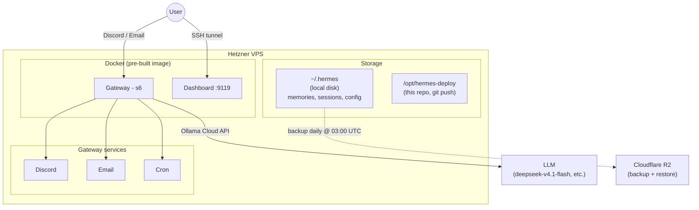

# Hermes Deploy

Personal deployment of [Hermes Agent](https://github.com/nousresearch/hermes-agent) on Hetzner Cloud, managed with Terraform.

Hermes is a self-improving AI agent with persistent memory, skills, and multi-platform messaging. This repo provides a reproducible, one-command deployment with custom agent profiles.

## Architecture



### How it works

Terraform manages three layers, each independently updatable:

| Layer | What | Triggers rebuild? |
|-------|------|-------------------|
| **cloud-init** | Docker install | Only on server size/region change |
| **setup script** | Clone repos, pull image, configure, restore backup | On config changes (re-runs over SSH, no rebuild) |
| **profiles script** | Deploy SOUL.md, himalaya config | On profile changes (re-runs over SSH, no rebuild) |

Data lives on the server's local disk with **R2 backups daily at 03:00 UTC**. On redeploy, the latest backup is restored automatically (max 24h data loss).

## Profiles

Agent personalities live in `profiles/`. Each profile has a `SOUL.md` that defines its character.

| Profile | Personality | Model | Description |
|---------|------------|-------|-------------|
| `default` | **Claudiano** (Claudio Bisio) | `deepseek-v4.1-flash` | Warm, witty, Italian slips when surprised |
| `coder` | **Eduardo De Filippo** ('o professore) | `glm-5.3-flash` | Brilliant coder, humble in appearance, theatrical precision |
| `bruno-barbieri` | **Bruno Barbieri** (chef stellato) | `deepseek-v4-pro:0813` | Code reviewer, technical perfectionist, culinary metaphors |
| `calvino` | **Italo Calvino** (Lezioni Americane) | `glm-5.3` | Writing reviewer, lightness, exactitude, visibility |
| `cannavacciuolo` | **Antonino Cannavacciuolo** (chef PM) | `deepseek-v4.1-flash` | Project/product manager, structured, "Forza e coraggio" |
| `researcher` | **Barbero** (Alessandro Barbero) | `deepseek-v4.1-flash` | Narrative historian, structured reports, ironic |

Create your own by adding a directory under `profiles/` with a `SOUL.md`.

## Prerequisites

- [Terraform](https://developer.hashicorp.com/terraform/downloads) >= 1.5
- A [Hetzner Cloud](https://www.hetzner.com/cloud) account + API token
- An [Ollama](https://ollama.com) cloud account + API key
- A [Cloudflare](https://dash.cloudflare.com) account with R2 enabled (for remote state + backups)
- A [Discord](https://discord.com/developers/applications) bot token (optional)
- A Gmail app password for email reading (optional)

## Quick Start

### 1. Fork and clone

```bash
# Fork this repo on GitHub, then:
git clone git@github.com:YOUR-USER/hermes-deploy.git
cd hermes-deploy/terraform
cp terraform.tfvars.example terraform.tfvars
```

### 2. Create a deploy key

This lets your Hermes agent push changes back to your repo (self-modification).

```bash
ssh-keygen -t ed25519 -f hermes_deploy_key -N '' -C 'hermes-deploy-key'
```

Add the **public** key (`hermes_deploy_key.pub`) to your GitHub fork:
**Settings → Deploy Keys → Add deploy key** (enable "Allow write access").

Copy both keys into `terraform.tfvars`:
- `deploy_key` — contents of `hermes_deploy_key` (private)
- `deploy_public_key` — contents of `hermes_deploy_key.pub`

### 3. Set up Cloudflare R2

Create two R2 buckets in the [Cloudflare dashboard](https://dash.cloudflare.com) (EU region):
- `hermes-tfstate` — for Terraform remote state
- `hermes-backups` — for hourly data backups

Create an R2 API token with **Object Read & Write** access to both buckets. Then create `.envrc` in the repo root:

```bash
export AWS_ACCESS_KEY_ID="your-r2-access-key"
export AWS_SECRET_ACCESS_KEY="your-r2-secret-key"
```

Load with `source .envrc` or install [direnv](https://direnv.net/).

Update the `backend "s3"` endpoint in `terraform/main.tf` with your Cloudflare account ID.

Add the same R2 credentials to `terraform.tfvars` as `r2_access_key_id` and `r2_secret_access_key`.

### 4. Configure

Edit `terraform.tfvars`. Required variables:

| Variable | Where to get it |
|----------|----------------|
| `hetzner_token` | [Hetzner Console](https://console.hetzner.cloud) → Security → API Tokens |
| `ssh_public_key` | `cat ~/.ssh/id_ed25519.pub` |
| `ollama_api_key` | [ollama.com](https://ollama.com) account settings |
| `deploy_repo` | `git@github.com:YOUR-USER/hermes-deploy.git` |
| `deploy_key` | Private key from step 2 |
| `deploy_public_key` | Public key from step 2 |
| `r2_access_key_id` | From step 3 |
| `r2_secret_access_key` | From step 3 |
| `user_timezone` | Your [IANA timezone](https://en.wikipedia.org/wiki/List_of_tz_database_time_zones) (e.g. `Europe/Berlin`) |

Optional: `discord_bot_token`, `discord_allowed_users`, `email_accounts`.

### 5. Deploy

```bash
cd terraform
terraform init
terraform apply
```

**Takes ~3 minutes.** Uses a pre-built Docker image from Docker Hub — no local build needed.

The deploy runs three stages:
1. Creates server + attaches volume (~30s)
2. Runs setup script over SSH: pulls image, clones repos, starts containers (~2 min)
3. Deploys profiles: copies SOUL.md files, configures himalaya, restarts gateway (~10s)

### 6. Access

```bash
# SSH into the server
ssh root@$(terraform output -raw server_ip)

# Dashboard (web UI) — accessible via SSH tunnel only
ssh -L 9119:127.0.0.1:9119 root@$(terraform output -raw server_ip)
# Then open http://localhost:9119
```

### Home VPN egress (WireGuard via the home router, always on)

Replaces the old manual `ssh -R 1080` tunnel, which only worked while the laptop was on. The home
ASUS router runs a WireGuard server; the VPS connects to it with
[wireproxy](https://github.com/windtf/wireproxy) (userspace WireGuard → SOCKS5 on
`127.0.0.1:1080`, plus HTTP on `127.0.0.1:1081`; systemd unit `wireproxy-home`, sandboxed, no
root). No kernel interface, no routes: SSH, email and R2 backups still leave directly from Hetzner.
What exits via the home IP:
- **Camofox** (`home_vpn_camofox`, see below).
- **The agents' web traffic** (`home_vpn_web`, default on): the gateway gets
  `HTTP(S)_PROXY=http://127.0.0.1:1081`, so `web_search`, `web_extract`, curl and git-over-https from
  the terminal go through home; SearXNG gets `outgoing.proxies` (SOCKS). `NO_PROXY` keeps Ollama,
  Discord, GitHub, Cursor, Google APIs, Nous and R2 direct, so the bots stay up when the home
  connection is down — only web lookups and the browser fail then. To add another direct
  endpoint, extend `WEB_NO_PROXY` in `setup-hermes.sh`.

Safety:
- Router side: WireGuard "Access Intranet" is **off** (`wgs1_lanaccess=0`) — VPN clients get
  internet only, no home LAN.
- VPS side: `AllowedIPs` is the public IPv4 internet only (RFC1918, CGNAT, loopback, link-local,
  multicast and reserved ranges excluded), so nothing using the proxy can reach the router
  (`10.6.0.1`/`192.168.x`) either. DNS goes through the tunnel to `1.1.1.1`/`9.9.9.9`.
- The home IP changes nightly (1&1 PPPoE reconnect, 04:00); the router updates its ASUS DDNS name
  and `wireproxy-home-check.timer` restarts the tunnel within ~5 min when the probe fails.

Setup (one-time, on the router — UI: VPN → VPN Server → WireGuard, or over SSH):
1. ASUS DDNS on (WAN → DDNS), WireGuard server on, Access Intranet off.
2. Add a client named `hetzner-hermes`.
3. Put its values in `terraform.tfvars` (`home_vpn_endpoint`, `home_vpn_server_public_key`,
   `home_vpn_client_private_key`, `home_vpn_client_address`), then `terraform apply`.
   Over SSH: `nvram get wgs1_pub` (server public key), `nvram get wgs1_c1_priv` (client private
   key), `nvram get wgs1_c1_addr` (client address, IPv4 part).
   Careful when setting the client over SSH: `wgs1_c1_aips` is the *router-side* AllowedIPs (`10.6.0.2/32`),
   `wgs1_c1_caips` the client's (`0.0.0.0/0`). Swapped, the router sends the whole home internet into the
   tunnel. After a router factory reset, all of this (and DDNS) is gone — see the casa runbook
   ("Router after a factory reset") in the workspace repo.

Leaving `home_vpn_client_private_key` empty disables all of it (the unit is removed, Camofox
goes direct). `home_vpn_camofox = false` keeps the tunnel up but Camofox direct;
`home_vpn_web = false` does the same for the gateway and SearXNG.

Check from the VPS:

```bash
curl -s --socks5-hostname 127.0.0.1:1080 https://api.ipify.org   # → home IP
systemctl status wireproxy-home wireproxy-home-check.timer
journalctl -u wireproxy-home-check -n 20                        # restarts after IP changes
```

## Choosing a Model

Hermes uses [Ollama Cloud](https://ollama.com) as the LLM provider. Set `ollama_model` in `terraform.tfvars`.

| Model | Best for | Notes |
|-------|----------|-------|
| `deepseek-v4.1-flash` | General use, PM (recommended) | Fast, strong reasoning, good at multi-step tool use |
| `kimi-k3` | Unused | Strongest Kimi, but ~7× the cost of `glm-5.3` per review ($3/$15 per 1M in/out) |
| `glm-5.3` | Code review (Bruno), writing review (Calvino) | Strong coding and language understanding, $0.26/$4.40 per 1M in/out |
| `glm-5.3-flash` | Coding (coder/KITT profile) | Fast coding specialist |
| `deepseek-v4-pro` | Complex reasoning | Slower, more expensive, 1.6T |
| `deepseek-v4-flash` | Retired | Superseded by `deepseek-v4.1-flash` |

Start with `deepseek-v4.1-flash` — it handles agentic workflows (tool calls, pagination, multi-step tasks) well. Smaller models struggle with tool use and may ignore the SOUL.md personality.

Check available models:
```bash
curl -H "Authorization: Bearer $OLLAMA_API_KEY" https://ollama.com/v1/models
```

## Email Setup

Hermes uses [himalaya](https://github.com/pimalaya/himalaya) for reading email via IMAP (read-only, no sending).

### Gmail app password

1. Enable [2-Step Verification](https://myaccount.google.com/signinandsecurity) on your Google account
2. Go to [App Passwords](https://myaccount.google.com/apppasswords)
3. Create a new app password (name it "Hermes")
4. Copy the 16-character password

See [Google's documentation](https://support.google.com/accounts/answer/185833) for details.

### Configuration

Add accounts in `terraform.tfvars`:

```hcl
email_accounts = [
  {
    name      = "gmail"
    email     = "you@gmail.com"
    password  = "abcd efgh ijkl mnop"  # app password from above
    imap_host = "imap.gmail.com"
    default   = true
  },
]
```

Supports any IMAP provider — just change `imap_host` (e.g. `outlook.office365.com` for Outlook, `imap.mail.yahoo.com` for Yahoo).

Multiple accounts are supported — the agent can switch between them.

## Self-Modification

This repo is cloned onto the server at `/opt/hermes-deploy`. The default agent (Claudiano) has instructions in its SOUL.md to manage the deployment:

- **Edit profiles** — update SOUL.md, create new profiles
- **Copy to live** — changes take effect immediately
- **Commit and push** — changes are versioned and survive redeploys

Ask your agent "update your personality to be more formal" or "create a new profile for coding help" — it will edit the files, copy to the live location, commit, and push.

The deploy key is scoped to this single repo only.

## Customizing Profiles

Replace the included profiles with your own. The `profiles/default/SOUL.md` is your main agent.

### Adding a new profile

1. Create `profiles/<name>/SOUL.md` with the personality
2. Optionally add `profiles/<name>/profile.yaml` with a description
3. Commit and push
4. Run `terraform apply` or ask your agent to pull the changes
5. On Discord, use `/profile <name>` to switch

### SOUL.md tips

- Define the agent's name, tone, and quirks
- Set language rules (which language to reply in)
- Add structured output formats for specialized profiles (e.g. research reports)
- Keep it concise — the model reads this on every message

## Camofox Browser Automation

[Camofox](https://github.com/jo-inc/camofox-browser) is a self-hosted anti-detection browser
server (Firefox fork with C++-level fingerprint spoofing) that gives Hermes' `browser_navigate`
tools a real, stateful browser — used specifically for sites SearXNG's plain-HTTP engines can't
handle: Reddit (requires an authenticated login, not just IP reputation) and, in principle,
JS-heavy/CAPTCHA-gated sites generally. **Not a reliable Google workaround** — see below.

Runs as its own container (`camofox-browser`), **host-networked** (`--network host`, like
`gateway`/`searxng`, not `docker-compose.override.yml`) — required so `127.0.0.1` inside the
container means the *host's* loopback, where the `hermes` container's API access
(`127.0.0.1:9377`) actually lives. Bound to loopback only at the application level
(`CAMOFOX_BIND_HOST=127.0.0.1`) for defense-in-depth, since host
networking removes Docker's own per-container port isolation. Deployed by
`terraform/scripts/setup-hermes.sh`.

**Proxied via the home VPN when it's configured** (`PROXY_HOST=127.0.0.1`, `PROXY_PORT=1080`,
`PROXY_PROTOCOL=socks5`, see [Home VPN egress](#home-vpn-egress-wireguard-via-the-home-router-always-on));
direct otherwise. The old reason for keeping Camofox direct was that the manual `ssh -R` tunnel
was usually down, which broke all browsing; the router tunnel is always on (and self-heals
after the nightly IP change). Known effects, from earlier testing with the manual tunnel: fixes
Blind and Glassdoor (see below), doesn't help Google, not needed for a persisted Reddit session.
Cost: every Camofox visit spends the *home* IP's reputation with that site — set
`home_vpn_camofox = false` to go back to direct. The setup script recreates the container when
the proxy setting changes (persisted logins survive on the volume).

**Memory**: the container is capped at `--memory=1536m` so a runaway browser gets OOM-killed inside
its own cgroup rather than triggering the host-wide OOM killer (which picks the biggest process —
before the cap, that regularly meant Hermes itself). `BROWSER_RSS_RESTART_THRESHOLD_MB=1000` makes
Camofox restart the browser on its own before reaching the cap, `MAX_OLD_SPACE_SIZE=512` raises the
Node heap from the image's 128MB default (which OOM-crashed under real use), and `--shm-size=1g`
replaces Docker's 64MB `/dev/shm`, too small for Firefox content processes. The host also has a 2GB
swapfile (`setup-hermes.sh`) for the same reason: the cx23's 3.8GB is tight with four gateways.

**Crash reporter off**: upstream enables it by default and it files *public* GitHub issues with
session/tab context. Disabled via `CAMOFOX_CRASH_REPORT_ENABLED=false`.

**Cookie import (optional)**: Camofox exposes `POST /sessions/:userId/cookies` to inject cookies
into a session directly — handy for bootstrapping a login (e.g. sign in once by hand, export
cookies, import them) without fighting a site's bot/CAPTCHA defenses through automation. Disabled
(403) unless `CAMOFOX_API_KEY` is set on the container, auth'd via `Authorization: Bearer
<key>`. Set `camofox_api_key` in `terraform.tfvars` (generate with `openssl rand -hex 32`) to
enable it — `setup-hermes.sh` passes it through and recreates the container on any change to it.
Left unset by default; everything else (navigation, persisted Reddit login, etc.) works without it.

### Version pinning and upgrades

Pinned in `setup-hermes.sh` to a release tag (`CAMOFOX_REF`, currently `v1.17.0`) plus the
Camoufox browser build it expects (`CAMOUFOX_VERSION`/`CAMOUFOX_RELEASE`, currently
`152.0.4`/`beta.28`). To upgrade, bump all three together, taking the Camoufox pair from the
`ARG` defaults in the upstream `Dockerfile` at that tag. The image is tagged with both, so the
next run of the script builds it, recreates the container (the `/opt/camofox-data` volume and its
logins survive) and removes the old image. Changing the `docker run` flags needs a
`CAMOFOX_RUN_REV` bump to trigger a recreate.

Trap: the upstream `Makefile` still defaults to Camoufox `135.0.1-beta.24` and passes it as a
`--build-arg`, overriding the `Dockerfile`'s pin. A plain `make build` pairs new server code with
an old browser whose protocol schema it doesn't match — the root cause of the viewport `isMobile`
errors we used to patch around. The script always passes `VERSION`/`RELEASE` explicitly.

Until `v1.17.0` we ran a Camoufox 135 build of `v1.11.2` with six `sed` patches for
Linux/Docker bugs. All are gone now, fixed or made configurable upstream: the `await` on
`VirtualDisplay.get()` landed; the viewport/health-probe `isMobile` errors came from the version
mismatch above; SOCKS5 proxying is `PROXY_PROTOCOL=socks5`; a failed GeoIP lookup now falls back to
`geoip: false` by itself; and binding to loopback is `CAMOFOX_BIND_HOST=127.0.0.1`. See the git
history for the old patch table.

### Reddit login

Reddit requires an authenticated session — SearXNG can't provide one, and there's no working
`reddit` engine (removed from SearXNG's config; see the git history if you want the story).
Camofox's browser persists cookies per fixed `userId` (`hermes-reddit`, set via
`browser.camofox.user_id` in `config.yaml`), bind-mounted to `/opt/camofox-data` on the host so
the session survives redeploys.

- Credentials: `reddit_username`/`reddit_password` in `terraform.tfvars` (dedicated throwaway
  account recommended, not a personal one) — same gitignored-secrets pattern as every other
  credential in this deploy. On every deploy, `restore-backup.sh` writes them into a narrow,
  Reddit-only file (`/root/.hermes/.reddit-credentials`, visible inside the hermes container at
  `/opt/data/.reddit-credentials`) — deliberately separate from `/tmp/hermes-deploy.env`, which
  holds every credential in the deployment (Discord tokens, R2 keys, email password, API keys).
  Claudiano/Barbero are told (in their SOUL.md) to run the recovery script themselves and never
  read the shared secrets file.
- Recovery script: `terraform/scripts/reddit-login.py`. Runs automatically on a fresh Camofox
  install (once the credentials file above exists). Also runnable manually, from the host or
  from inside Claudiano/Barbero's own sandbox (same repo path is mounted in both places):
  `python3 /opt/hermes-deploy/terraform/scripts/reddit-login.py`. It checks whether the
  persisted session is still valid *before* attempting anything, and exits immediately if so —
  safe to run speculatively/repeatedly without risking extra login attempts against Reddit's
  fraud detection.
- If Reddit's login form shows "Something went wrong logging in," that's Reddit's login-specific
  fraud scoring reacting to repeated attempts in a short window, not a credentials/IP problem —
  confirmed by testing the same account, same IP, spaced further apart, succeeding cleanly.
  Hammering retries risks flagging the account further; wait between attempts instead. The
  check-before-login behavior above exists specifically to avoid Claudiano/Barbero triggering
  this by running the recovery script defensively.

### Google — not solved, don't chase it further

Google's CAPTCHA isn't a config problem the way Reddit's was. Tested exhaustively: SearXNG's
`google` engine gets CAPTCHA'd with or without the search proxy; Camofox gets blocked with or
without the proxy too — and each block names the exact IP that got flagged (home IP when
proxied, Hetzner IP when not), confirming Google's detection reacted to the *volume* of
automated queries sent from this deployment during development, not a fixable IP-reputation or
config issue. More retries just add to that history and extend the block. `google` is left
configured but shouldn't be relied on until it's had time to cool down on its own — there's
nothing to fix here, just time and reduced query volume.

**News category**: `duckduckgo news`, `wikinews`, `mojeek news`, `bing news` — separate engines
from general search (`google`/`duckduckgo`/etc.), added so a block on the general category
doesn't take news queries down with it. `duckduckgo`/`wikipedia`/`github` (general search) remain
reliable fallbacks in the meantime too.

### General search went dark (2026-11) — fixed with `seznam` + `bing`

By mid-November 2026 the general category had gone completely dark: `google` silently returned
nothing, `duckduckgo` → `CAPTCHA`, `startpage` → `Suspended: CAPTCHA`, `brave` → `too many
requests`, all from the Hetzner IP. So `/search?format=json` answered 0 results for ordinary
queries while every other kind of egress (APIs, RSS, `curl`) kept working — the tell that it was
the engines, not the network or the container. Probed one engine at a time: `seznam` and `bing`
still answer from this IP (`bing`'s parsed results are weak, often matching only the first query
word, hence the second-opinion role), while `mojeek`/`qwant`/`presearch`/`yahoo` return
`access denied`/`HTTP protocol error`.

Two layers to the fix:

- **SearXNG side** — `seznam` + `bing` now carry the `general` category and the four blocked
  engines are `disabled: true` (they only cost their timeouts). Canonical list lives in
  `terraform/scripts/setup-hermes.sh` and `terraform/scripts/fix-searxng-engines.sh`. SearXNG
  only reads `settings.yml` at start, so re-applying needs a host-side restart:

  ```bash
  ssh root@$(terraform output -raw server_ip) 'bash -s' < terraform/scripts/fix-searxng-engines.sh
  ```

  Operator action, like the Camofox/proxy items above — the agent container has no Docker socket
  and no `/opt/searxng` mount.
- **Hermes side** — `web.search_backend: exa` in every profile and the root `config.yaml`, which
  routes `web_search` to Exa's **anonymous keyless tier** (no key; the keyless ring fails over to
  `parallel`/`firecrawl`/`keenable` on rate limits). Verified from this host for trivial,
  technical and current-events queries while SearXNG's general category was empty. Once SearXNG
  answers again, set `search_backend` back to `searxng` for local, quota-free search.

### Blind and Glassdoor — solved via the home VPN

Unlike Google, these two are a genuine IP-reputation block, not a request-pattern one — confirmed
directly: Blind returns a CloudFront-cached 403 (a static "Oops! Something went wrong" page,
`x-cache: Error from cloudfront`) and Glassdoor returns a Cloudflare Challenge
(`cf-mitigated: challenge`) from this server's datacenter IP, on both a plain `curl` *and* a real
Camofox browser. Through a home-IP proxy both load cleanly — but only in Camofox, since a plain
`curl` through the same proxy still gets blocked (these sites fingerprint the request, not just
the IP — a real browser is required either way).

With [Home VPN egress](#home-vpn-egress-wireguard-via-the-home-router-always-on) configured and
`home_vpn_camofox = true` (the default), Camofox is proxied permanently, so this works without
any operator action. (Before the router tunnel this needed the laptop's `ssh -R` tunnel plus a
manual Camofox recreate.)

A persisted, logged-in Blind session (Camofox userId `hermes-reddit`, same fixed identity as
Reddit) is already set up — recovery script is `terraform/scripts/blind-login.py`
(`blind_username`/`blind_password` in `terraform.tfvars`, same narrow-credentials-file pattern as
Reddit). It only works while Camofox is proxied; it detects and reports that clearly rather than
failing confusingly if not.

## dario (non-Claude model router)

[dario](https://github.com/askalf/dario) runs as an optional standalone container (`dario`, pinned in `setup-hermes.sh`) on `127.0.0.1:3456`, exposing one OpenAI- and Anthropic-compatible endpoint in front of a ChatGPT subscription and/or API-key backends. It is installed only when `dario_api_key` is set in `terraform.tfvars` (`openssl rand -hex 32`).

**Claude is disabled on purpose** (`--no-claude-auth`): routing a Claude subscription through a third-party proxy violates Anthropic's terms and gets accounts banned. Never run `dario login` on this server.

Accounts and backends are added once, interactively, and stored in `/opt/dario-data` (kept out of `/root/.hermes` so the agents can't read the tokens, and therefore **not** in the R2 backup — re-add them after a fresh deploy):

```bash
# ChatGPT subscription (prints a URL to open in any browser, paste the code back)
docker exec -it dario node /app/dist/cli.js add altman

# Any OpenAI-compatible API-key backend
docker exec -it dario node /app/dist/cli.js backend add openrouter --key=sk-or-... --base-url=https://openrouter.ai/api/v1

docker exec dario node /app/dist/cli.js doctor   # what's loaded and routable
```

Inside the gateway, `DARIO_URL` (`http://127.0.0.1:3456/v1`) and `DARIO_API_KEY` are set. Models are addressed by their ChatGPT slug, or as `<backend>:<model>` for API-key backends. `docker ps` shows the container as "unhealthy" until a ChatGPT account exists (and permanently with API-key backends only) — harmless, use `curl -s 127.0.0.1:3456/livez` instead.

## Data Persistence

```
┌─────────────────────────────────┐
│  Server local disk              │
│  ~/.hermes/                     │
│  ├── memories/                  │
│  ├── sessions/                  │
│  ├── config.yaml                │
│  ├── profiles/                  │
│  └── skills/                    │
└────────────┬────────────────────┘
             │ rclone sync daily @ 03:00 UTC
             ▼
┌─────────────────────────────────┐
│  Cloudflare R2 (free)           │
│  hermes-backups/latest/         │
└─────────────────────────────────┘
```

- **Local disk**: all Hermes data lives here. Wiped on server rebuild.
- **R2 backup**: daily at 03:00 UTC via rclone cron. On redeploy, the setup script restores the latest backup automatically. Max 24 hours of data loss.
- **Force backup before redeploy**: `ssh root@<ip> /usr/local/bin/hermes-backup`

## Project Structure

```
hermes-deploy/
├── README.md
├── .envrc                              # R2 credentials (gitignored)
├── .gitignore
├── TODO.md
├── profiles/
│   ├── default/
│   │   └── SOUL.md                     # Default agent personality
│   ├── coder/
│   │   ├── SOUL.md                     # Eduardo De Filippo coder
│   │   └── profile.yaml
│   ├── bruno-barbieri/
│   │   ├── SOUL.md                     # Bruno Barbieri code reviewer
│   │   └── profile.yaml
│   ├── calvino/
│   │   ├── SOUL.md                     # Italo Calvino writing reviewer
│   │   └── profile.yaml
│   ├── cannavacciuolo/
│   │   ├── SOUL.md                     # Antonino Cannavacciuolo PM
│   │   └── profile.yaml
│   └── researcher/
│       ├── SOUL.md                     # Barbero researcher
│       └── profile.yaml
└── terraform/
    ├── main.tf                         # Provider, backend, resources
    ├── variables.tf                    # All inputs
    ├── outputs.tf                      # IP, SSH, tunnel commands
    ├── cloud-init.yaml                 # Minimal: Docker + volume mount
    ├── himalaya.toml.tftpl             # Email config template
    ├── terraform.tfvars                # Your secrets (gitignored)
    ├── terraform.tfvars.example        # Template for new users
    └── scripts/
        ├── setup-hermes.sh             # Pull image, configure, start
        ├── deploy-profiles.sh          # Deploy SOUL.md + himalaya config
        └── setup-backups.sh            # R2 backup cron via rclone
```

## Troubleshooting

### Bot replies twice to every message

The Hermes image runs an s6 supervisor that starts a gateway. If the Docker CMD also starts one, you get duplicates. This repo sets CMD to `sleep infinity` via `docker-compose.override.yml` and disables the reconcile-profiles script in the dashboard container. Check with:

```bash
docker exec hermes ps aux | grep "hermes gateway" | grep -v grep
```

Should show exactly one `hermes gateway run` process.

### Bot doesn't use the SOUL.md personality

- **Small models** (gemma3:4b) often ignore system prompts. Use `deepseek-v4.1-flash` or larger.
- Check the file: `docker exec hermes cat /opt/data/SOUL.md`
- SOUL.md is loaded per-message — no restart needed after editing.

### Himalaya email errors

- **"config not found"**: run `docker exec hermes ln -sf /opt/data/.config/himalaya /opt/data/home/.config/himalaya`
- **TOML parse error**: use `backend.encryption.type = "tls"` not `backend.encryption = "tls"`

### SSH key not working after redeploy

A redeploy creates a new server with a new host key:

```bash
ssh-keygen -R $(terraform output -raw server_ip)
```

### Dashboard not loading

The dashboard is on port **9119** (not 7860):

```bash
ssh -L 9119:127.0.0.1:9119 root@$(terraform output -raw server_ip)
```

### Restoring from backup

A brand-new server automatically restores from the latest R2 backup on first deploy. On an
*already-provisioned* server, `terraform apply` skips this — it's the single biggest cost of a
deploy (often 5+ minutes, dominated by per-object overhead across thousands of small files, not
actual data volume), and on a live server the restore has nothing to accomplish that cron's own
30-minute backup cycle doesn't already handle. Force it anyway for a genuine one-off (disaster
recovery, suspected local corruption):

```bash
terraform apply -var="force_restore=true"
```

Deliberately a CLI flag, not a `terraform.tfvars` entry — set there, it would force a restore on
every future apply too.

To restore manually without going through Terraform at all:

```bash
ssh root@$(terraform output -raw server_ip)
rclone copy r2:hermes-backups/latest/ /root/.hermes/ --transfers 4
chown -R 10000:10000 /root/.hermes/
cd /opt/hermes && docker compose restart gateway
```

### Gateway not starting after deploy

Don't use `s6-svc -u/-d` directly — confirmed the hard way that it only changes the *current*
container's runtime state. A boot-time hook (`container_boot.py`, wired in as
`/etc/cont-init.d/02-reconcile-profiles`) reads each profile's persisted
`profiles/<name>/gateway_state.json` on every container start and auto-restarts exactly the
profiles whose `desired_state` says `"running"` — a raw `s6-svc` stop doesn't touch that field, so
the very next restart silently undoes it. Use the CLI, which does write `desired_state` correctly:

```bash
docker exec hermes /opt/hermes/.venv/bin/hermes gateway start
```

For a named profile (not the shared default bot), point `HERMES_HOME` at its directory:

```bash
docker exec -e HERMES_HOME=/opt/data/profiles/<name> hermes /opt/hermes/.venv/bin/hermes gateway start
```

Check status for every profile at once: `docker exec hermes /opt/hermes/.venv/bin/hermes gateway list`

Check logs: `docker exec hermes cat /opt/data/logs/gateway.log | tail -20` (or, for a named
profile, `/opt/data/profiles/<name>/logs/gateway.log`)

## Costs

| Service | Cost |
|---------|------|
| Hetzner VPS | ~€5-8/month (cx22/cx23) |
| Ollama Cloud | Pay-per-use (model dependent) |
| Cloudflare R2 | Free (10GB storage, no egress) |
| Discord / Email | Free |
